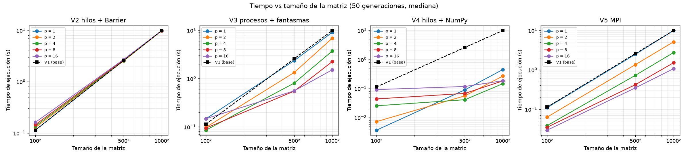
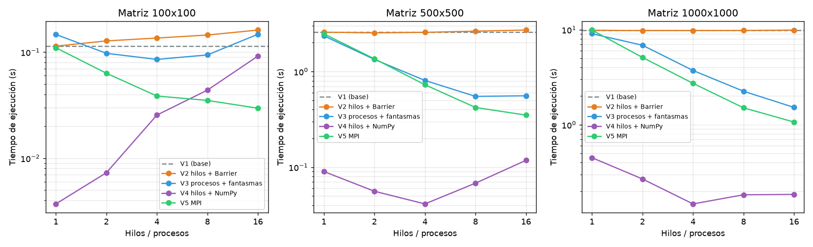
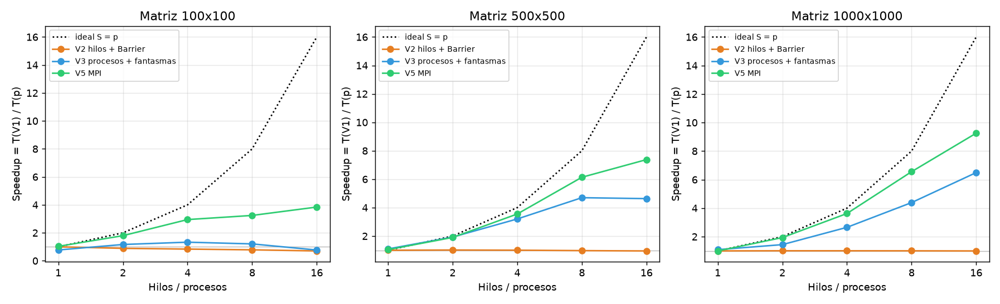
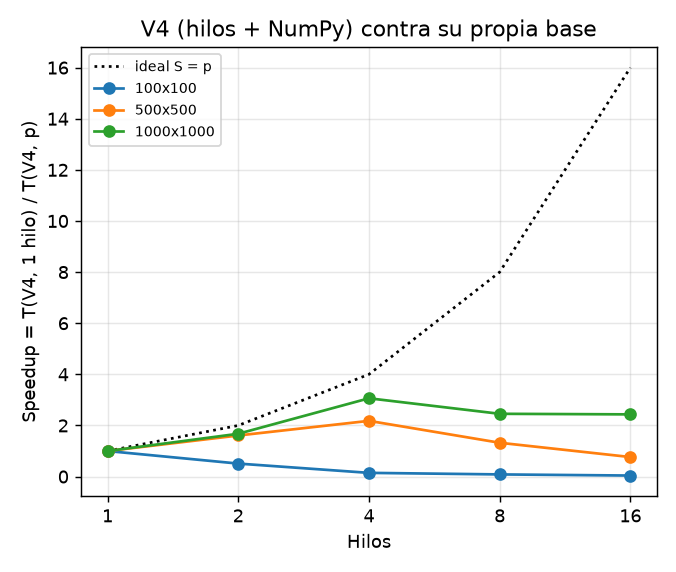
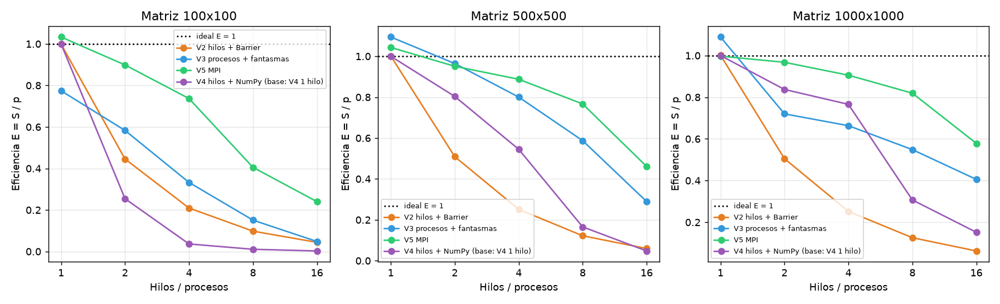

# Juego de la Vida paralelo — Informe

**Curso:** Infraestructuras Paralelas y Distribuidas (750023C) · 2026-2 · Profesor: Manuel Alejandro Pastrana Pardo
**Parcial I:** Paralelismo en Acción — Creación de un Juego Paralelizado
**Integrantes:** _(completar nombres y códigos; máximo 3)_

## 1. Introducción y objetivo
Se implementó el Juego de la Vida de Conway sobre una matriz de celdas vivas/muertas con una versión
secuencial (referencia) y cuatro versiones paralelas, todas en Python:

| Versión | Técnica | Qué demuestra |
|---|---|---|
| V1 | Secuencial, Python puro | Base de comparación |
| V2 | Hilos (`threading`) + `Barrier` | Los *Threads* del enunciado; efecto del GIL |
| V3 | Procesos (`ProcessPoolExecutor`) + filas fantasma | Paralelismo real sin memoria compartida |
| V4 | Hilos + NumPy (SMP + SIMD) | Híbrido visto en el Taller 4 |
| V5 | MPI (`mpi4py`, MS-MPI) | Paso de mensajes: intercambio de filas frontera |

El objetivo es mostrar **cuándo ayuda el paralelismo y cuándo no**. El enunciado permite Threads *o* MPI;
se implementaron ambos y un parámetro (`config.MODO_PARALELO`, `--modo`) decide cuál usar. Se entregan
también una GUI en pygame que simula el juego con cualquiera de las versiones, el benchmark, las gráficas
y las pruebas de correctitud.

## 2. El juego y decisiones de diseño
**Reglas** (enunciado): viva con <2 vecinos muere (soledad); con 2 o 3 sobrevive; con >3 muere
(sobrepoblación); muerta con exactamente 3 vecinos nace.

| Decisión | Elección | Justificación |
|---|---|---|
| Frontera | **Muerta** (fuera de la matriz = celdas muertas) | El enunciado no define el borde; es la lectura más directa de "una matriz de células": una celda del borde simplemente tiene menos vecinos. En las bandas de los extremos, la fila fantasma es una fila de ceros. Misma frontera en todas las versiones (si no, la comparación no sería válida). |
| Lenguaje | Python | Es el de los talleres del curso; la GUI y las gráficas quedan en un solo lenguaje. |
| Threads **y** MPI | Ambos, seleccionables | Permite comparar memoria compartida vs. paso de mensajes con el mismo kernel. |
| División | **Bandas de filas** | Una fila es memoria contigua (localidad de caché); la frontera de cada banda son solo 2 filas; reparto simple. Bloques 2D reducirían el perímetro solo con muchos trabajadores y obligan a manejar 8 vecinos y esquinas entre bloques. |
| Matriz | Lista de `bytearray` (0/1) | Mutable (la GUI pinta celdas), compacta, y una fila se envía barata a otro proceso. V4 y la GUI la convierten a NumPy en los bordes. |
| Regla | Escrita **una sola vez** (`core/rules.py`) | Si cada versión copiara la regla, la comparación de rendimiento dejaría de ser justa: solo cambia *quién* recorre *qué* filas. |

## 3. Implementación secuencial (V1)
- **Doble búfer:** `compute_rows` lee de `actual` y escribe en `siguiente`; al terminar la generación se
  intercambian las *referencias* (no se copian celdas). Con una sola matriz, una celda ya actualizada
  contaminaría a su vecina y el resultado dependería del orden de recorrido.
- **Kernel por filas** (`compute_rows`): suma, columna a columna, las tres filas vecinas y luego tres
  columnas contiguas; el bucle interno no usa módulos ni índices. Una celda vive en la siguiente
  generación si la suma de su ventana 3×3 vale 3, o vale 4 y la celda estaba viva.
- **Referencia lenta:** `count_neighbors` + `next_cell_state` aplican la regla celda a celda tal como la
  escribe el enunciado; los tests comprueban que el kernel rápido da lo mismo.
- **Trampa serial:** el bucle de generaciones no se puede paralelizar (la generación *t+1* depende de la
  *t*); lo paralelizable es el trabajo *dentro* de cada generación (las celdas son independientes).
- **Semilla fija** (`config.SEMILLA`, generador `random.Random(seed)` propio): todas las versiones y todas
  las pruebas parten del mismo estado inicial.

## 4. Estrategia de paralelización
**Descomposición por dominio** (Sesión de descomposición, Taller 2): la matriz se divide en bandas
contiguas de filas, una por trabajador. El reparto balancea la carga: con `h` filas y `p` trabajadores,
las primeras `h mod p` bandas reciben una fila más (1000 filas / 7 = seis bandas de 143 y una de 142).
Si `p > h`, `p` se limita a `h`.

**Ciclo de una generación (común a todas las versiones):**
```
  [ cada trabajador: calcula SU banda de la generación t+1 leyendo la generación t ]
                              │
              ── sincronización (barrera / espera de resultados / mensajes) ──
                              │
                    la generación t+1 pasa a ser la actual
```

- **V2 – hilos + Barrier.** `p` hilos *persistentes* (se crean una vez). Cada hilo calcula su banda de
  `siguiente` y espera en una `Barrier` por generación cuya *acción* (la ejecuta un solo hilo) intercambia
  `actual` y `siguiente`. Dos barreras más (inicio y fin de `run`, con `p+1` partes para incluir al hilo
  que llama) permiten reutilizar los mismos hilos. Los hilos leen `actual` (compartida, solo lectura) y
  escriben filas disjuntas de `siguiente`: **no hay ningún Lock en el cómputo**.
- **V3 – procesos + filas fantasma.** Un `ProcessPoolExecutor` persistente. Cada generación se envía a
  cada proceso su banda más una fila vecina arriba y otra abajo (*filas fantasma*; en la primera
  y la última banda, la fantasma exterior es una fila de ceros); el worker devuelve su banda nueva. Los resultados se recogen con
  `as_completed` guardando a qué banda corresponde cada `future` y se ensamblan en orden. La espera de
  todos los resultados es la sincronización. Se paga la **copia** de datos (pickle) en cada generación.
- **V4 – híbrida SMP + SIMD.** Hereda de V2 (mismos hilos, bandas y barrera) y solo cambia el kernel:
  cada hilo cuenta vecinos sumando 8 vistas desplazadas de un arreglo NumPy y aplica las reglas con
  operaciones vectorizadas. NumPy libera el GIL en operaciones grandes, de modo que los hilos sí
  aportan algo.
- **V5 – MPI.** El proceso principal lanza `p` workers (`MPI.COMM_SELF.Spawn`). Cada worker **conserva
  su banda** entre generaciones y en cada una intercambia con sus vecinos **solo las filas de borde**
  mediante `Sendrecv` con sus vecinos (los workers de los extremos no tienen vecino por un lado:
  `MPI.PROC_NULL`, y su fantasma queda en ceros = borde muerto); luego calcula con el
  mismo kernel. El padre solo coordina (`run`) y reúne las bandas cuando hace falta (`snapshot`).

Todas las versiones comparten el contrato `Engine` (`run`, `step`, `snapshot`, `close`); la GUI, el
benchmark y los tests dependen solo de él, así que cambiar de versión no toca nada más.

## 5. Desafíos encontrados y cómo se resolvieron
1. **Condiciones de carrera.** Con doble búfer y filas disjuntas no hay dos escritores sobre la misma
   celda, por lo que no se necesita Lock; “la mejor sincronización es la que no necesitas”. Un Lock
   solo sería necesario para un contador compartido (p. ej. celdas vivas); se evita calculando parciales
   por trabajador y sumándolos al final.
2. **Sincronización entre generaciones.** Ningún hilo puede empezar la generación *t+1* hasta que todos
   terminaron de escribirla: la `Barrier` con acción de intercambio garantiza además que todos ven el
   *swap* antes de continuar.
3. **Deadlock con `Barrier`.** Un número de partes incorrecto cuelga el programa, y un hilo que falla
   con excepción deja a los demás esperando para siempre. Se usa `timeout`, se captura
   `BrokenBarrierError`, el primer error se guarda y se re-lanza en `run()`, y la barrera se aborta para
   liberar a los demás. Se comprobó inyectando un fallo en un hilo: `run()` propaga el error y `close()`
   termina sin colgarse.
4. **El GIL.** Con kernel en Python puro, los hilos no aceleran (ver §8). Es el hallazgo central de V2.
5. **Costo de arranque en Windows (*spawn*).** V3 y V5 tardan segundos en crear `p` procesos. Se crean una
   sola vez en `__init__`, el tiempo se mide **aparte** (`tiempo_setup_s`) y se hace un calentamiento
   antes de cronometrar. Con un solo ciclo de calentamiento algunos procesos seguían arrancando durante
   las primeras generaciones (se vio al perfilar: 400 ms/gen al principio, 34 ms después); se corrigió
   repitiendo el calentamiento hasta que respondan los `p` procesos.
6. **Bordes y esquinas.** Una celda de la esquina tiene solo 3 vecinos. Se resuelve rellenando cada fila
   con un 0 a cada lado y usando filas de ceros para el eje vertical; se prueba con un glider que choca
   contra la esquina y un blinker pegado al borde, comparando generación a generación con una
   implementación de referencia celda a celda. En V5, los extremos usan `MPI.PROC_NULL`.
7. **`as_completed` no respeta el orden de las bandas.** Se guarda el índice de cada `future` antes de
   ensamblar.
8. **MPI en Windows.** MS-MPI solo permite `Spawn` si el proceso padre arranca bajo `mpiexec`
   (`mpiexec -n 1 python -m ...`); sin él, V5 se declara “no disponible” con un mensaje claro (la GUI no
   se cae) y el resto de las versiones sigue funcionando.
9. **Comparación justa de V4.** V4 es ~22–31× más rápida que V1 *solo por vectorizar*. Compararla con V1 y
   llamarlo “speedup de paralelismo” sería engañoso; su speedup se calcula contra **V4 con 1 hilo**.

## 6. Metodología de pruebas
**Hardware** (`results/hardware.txt`): AMD Ryzen 7 8845HS, **8 núcleos físicos / 16 lógicos**, 15,3 GB de
RAM, Windows 11, Python 3.14.5 **con GIL**, NumPy 2.5.3, mpi4py 4.1.2 (MS-MPI 10.1), plan de energía
“Equilibrado”.

**Verificación de correctitud previa a medir** (`python -m tests.verify_correctness`, `test_patterns`,
`test_partition`):
- Kernel rápido = regla celda a celda del enunciado.
- V2, V3, V4 y V5 = V1 (comparación celda a celda y por hash) en 4 tamaños (30×40, 1000×16, 5×9, 3×3),
  `p ∈ {1, 2, 3, 4, 7, 8}` (incluye filas no divisibles y `p > h`) y 1, 2, 10 y 50 generaciones:
  **24/24 configuraciones por versión, todas iguales a V1.**
- Blinker (periodo 2), glider (+1,+1 cada 4 generaciones) y bloque (estable, también en dos esquinas),
  colocados sobre la frontera entre bandas, con `p ∈ {1, 2, 4, 8}`: todo OK.
- Bordes: un glider que choca contra la esquina y dos blinkers pegados a los bordes (uno en la frontera entre
  bandas) coinciden, generación a generación (12), con la regla celda a celda (oráculo), `p ∈ {1, 2, 4, 8}`.
- Se comprobó que los tests *detectan* errores: al romper a propósito la fila fantasma de V3, los tres
  tests de patrones fallan.

**Benchmark** (`python -m benchmark.run_benchmark`, sin GUI): tamaños 100, 500 y 1000 (matriz cuadrada);
`p ∈ {1, 2, 4, 8, 16}`; **50 generaciones**; **7 repeticiones**; se reporta la **mediana**. Se cronometra
solo `run(50)` con `time.perf_counter` tras un calentamiento de 1 generación; el arranque de hilos/procesos
se mide aparte. Misma semilla (12345, densidad 0,30) en todas las pruebas. El speedup es
`S(p) = T(V1) / T(p)`, siempre contra V1 (nunca contra V2/V3 con 1 trabajador); para V4 la base es V4 con
1 hilo. La eficiencia es `E = S/p` y la fracción serial se estima con Amdahl:
`f ≈ (1/S − 1/p) / (1 − 1/p)`. V5 se midió en una corrida aparte bajo `mpiexec` (se agrega al mismo CSV).

**Control de calidad de las mediciones.** El equipo es un portátil con aplicaciones en segundo plano (no se
pudieron cerrar todas) y la primera tanda salió con ruido. Por eso: (a) se repitió el barrido completo;
(b) V3 se volvió a medir por separado en primer plano, porque dentro del barrido en segundo plano salía
~25 % más lento de lo que rinde aislado (V3 con 1 proceso debe rendir como V1: 1,03× medido aislado);
(c) se comprobó que el kernel de borde muerto rinde igual que el de la primera versión (207 vs 214 ms por
generación en 1000×1000), de modo que la diferencia no era del código. Aun así, los números son de una
sola máquina y tienen ruido de unos pocos puntos porcentuales; una repetición de V3 (p=1, 1000×1000) tardó
1151 s, casi seguro porque el equipo se suspendió, y la mediana no se ve afectada.

## 7. Resultados y gráficas
Datos completos: `results/tiempos.csv` (441 mediciones) y `results/resumen.md`.







**Speedup contra V1 (mediana de 7 repeticiones, 50 generaciones, frontera muerta)**

| Matriz | V1 (s) | Versión | p=1 | p=2 | p=4 | p=8 | p=16 |
|---|---|---|---|---|---|---|---|
| 100×100 | 0,114 | V2 hilos | 1,00 | 0,89 | 0,84 | 0,78 | 0,70 |
| | | V3 procesos | 0,77 | 1,17 | 1,33 | 1,21 | 0,77 |
| | | V5 MPI | 1,03 | 1,80 | 2,95 | 3,24 | 3,84 |
| 500×500 | 2,582 | V2 hilos | 1,00 | 1,02 | 1,01 | 0,98 | 0,95 |
| | | V3 procesos | 1,09 | 1,93 | 3,20 | 4,70 | 4,63 |
| | | V5 MPI | 1,04 | 1,90 | 3,55 | 6,13 | 7,38 |
| 1000×1000 | 9,879 | V2 hilos | 1,00 | 1,01 | 1,01 | 1,01 | 1,00 |
| | | V3 procesos | 1,09 | 1,44 | 2,65 | 4,39 | 6,49 |
| | | V5 MPI | 1,00 | 1,94 | 3,62 | 6,56 | 9,26 |

**V4 (hilos + NumPy), speedup contra V4 con 1 hilo** (tiempo de V4 con 1 hilo entre paréntesis):

| Matriz | p=2 | p=4 | p=8 | p=16 | Factor de V4(1 hilo) sobre V1 |
|---|---|---|---|---|---|
| 100×100 (0,004 s) | 0,51 | 0,15 | 0,08 | 0,04 | 30,7× |
| 500×500 (0,090 s) | 1,61 | 2,18 | 1,32 | 0,76 | 28,7× |
| 1000×1000 (0,450 s) | 1,67 | 3,06 | 2,46 | 2,43 | 21,9× |

**Costo de arranque (`tiempo_setup_s`, mediana, 1000×1000):** V2 ≈ 0,003–0,006 s; V3 ≈ 0,5 s (p=1), 7,2 s
(p=8), 17,3 s (p=16); V5 ≈ 0,5 s (p=1), 8,5 s (p=8), 15,9 s (p=16). Es un costo fijo que se amortiza solo
si la simulación es larga.

**Fracción serial estimada (Amdahl), 1000×1000:** V5 ≈ 0,03 (p=4 y 8); V3 ≈ 0,17 (p=4) y 0,12 (p=8);
V4 ≈ 0,10–0,32 (p=4 a 8).

## 8. Análisis y conclusiones
1. **V2 (hilos, Python puro) no acelera: speedup ≈ 1 en todos los tamaños** (0,95–1,02 con hasta 16 hilos
   en 500 y 1000; baja a 0,70 en 100×100). Es el efecto del **GIL**: solo un hilo ejecuta bytecode de Python
   a la vez, así que los hilos se turnan y solo añaden barreras. La fracción serial estimada ≈ 1 lo
   confirma: para este kernel el programa se comporta como 100 % serial. Es un resultado válido y esperado,
   no un error: V2 coincide con V1 en 24/24 comparaciones.
2. **Los procesos sí escalan (V3 y V5), porque cada proceso tiene su propio intérprete y su GIL.** En
   1000×1000 con 8 procesos: V3 = 4,4× y V5 = 6,6× (eficiencias 0,55 y 0,82). Con 16 procesos:
   6,5× y 9,3×.
3. **El tamaño importa.** En 100×100 el trabajo por generación (≈ 2 ms) es comparable al costo de
   sincronizar/comunicar: V3 apenas llega a 1,3× (y con 16 procesos queda en 0,77×, peor que V1) y V5 a 3,2× con
   8 procesos (eficiencia 0,41). A mayor matriz, la razón cómputo/comunicación sube (el cómputo crece con
   *h·w* y la frontera solo con *w*) y el speedup crece: con 1000×1000 la eficiencia con 4 procesos es 0,66
   (V3) y 0,91 (V5). Es la conclusión principal: **el paralelismo ayuda cuando hay trabajo suficiente para
   amortizar su costo, y rinde poco o perjudica cuando no.**
4. **V5 (MPI) supera a V3 en 500 y 1000** (6,6× vs 4,4× con 8 procesos en 1000×1000). Nuestra
   interpretación, consistente con las fracciones seriales medidas (≈ 0,03 vs ≈ 0,12): V3 reconstruye y
   reenvía las bandas desde el proceso principal en cada generación y ensambla el resultado (parte serial
   que se repite 50 veces), mientras que en V5 cada worker conserva su banda y solo intercambia 2 filas
   por generación. No se aisló esta causa con una medición dedicada, por lo que se presenta como
   explicación más probable y no como hecho comprobado.
5. **El speedup se estanca al pasar los núcleos físicos.** La máquina tiene 8 núcleos físicos y 16 lógicos
   (SMT): de 8 a 16 procesos, V5 pasa de 6,6× a 9,3× en 1000×1000 (de 6,1× a 7,4× en 500×500) y la
   eficiencia cae de 0,82 a 0,58; en V3 con 500×500 prácticamente no hay mejora (4,70× → 4,63×). Un núcleo
   lógico extra no equivale a un núcleo físico, y además crecen los costos de comunicación y de arranque
   (hasta ~17 s con 16 procesos).
6. **V4 aísla el efecto de SIMD vs SMP.** Solo vectorizar con NumPy (V4 con 1 hilo) ya es ≈ 22–31× más
   rápido que V1: **esa es la mayor ganancia de todo el proyecto**, y no es paralelismo de hilos. Sobre esa
   base, los hilos aportan hasta 3,06× con 4 hilos en 1000×1000 (NumPy libera el GIL en operaciones
   grandes, por lo que a diferencia de V2 aquí los hilos sí ayudan), y se estancan en 2,4× con 8 y 16.
   Con bandas pequeñas el efecto se invierte: en 100×100, más hilos *empeoran* (0,51× con 2 y 0,15× con 4)
   porque el trabajo de cada banda es menor que el costo de la barrera y de las operaciones NumPy. El
   mejor caso de V4 es ≈ 67× más rápida que V1 (4 hilos, 1000×1000), pero ese factor mezcla vectorización
   y paralelismo y por eso no se usa como “speedup”.
7. **Ley de Amdahl.** Con f ≈ 0,03 (V5) y f ≈ 0,12 (V3), el máximo teórico con 8 procesos es
   1/(f + (1−f)/8) ≈ 6,6× y 4,4×, prácticamente lo medido (6,56× y 4,39×); la parte serial (empaquetado,
   ensamblado, intercambio, coordinación del padre) y los costos por generación explican por qué no se
   alcanza S = p.
8. **Limitaciones.** (a) Medidas en una sola máquina y sistema operativo, con el plan de energía
   “Equilibrado” y aplicaciones en segundo plano; hubo ruido y por eso se repitieron las mediciones (ver §6).
   Las diferencias de unos pocos puntos entre versiones no son concluyentes; las conclusiones se apoyan en
   las diferencias grandes. (b) V3 con 2 procesos en 1000×1000 (1,44×, eficiencia 0,72) rinde peor que la
   misma versión en 500×500 (1,93×), un comportamiento que no explicamos y que podría ser ruido residual.
   (c) Se probó solo matriz cuadrada, una densidad (0,30) y frontera muerta. (d) La GUI usa una matriz
   moderada y no sirve para medir rendimiento (en esa escala V1 puede ir más rápida que las paralelas).
   (e) El arranque de procesos en Windows (*spawn*) es lento y no se optimizó (p. ej. memoria compartida).

**Conclusión general.** Para este problema (*stencil* con dependencia entre generaciones y fronteras
pequeñas) el paralelismo es efectivo cuando se evita el GIL (procesos o MPI) y la matriz es suficientemente
grande (≥ 500×500); con hilos y Python puro no hay ganancia, y la vectorización supera por mucho a añadir
hilos o procesos. MPI, al conservar los datos en cada proceso, escala mejor que reenviar las bandas a un pool.

## 9. Referencias
- Enunciado del Parcial I (`Parcial I.pdf`), Infraestructuras Paralelas y Distribuidas 2026-2.
- Arpaci-Dusseau, *Operating Systems: Three Easy Pieces* (OSTEP), caps. 28–30 (locks, variables de
  condición, semáforos).
- Documentación de Python: `threading` (`Barrier`), `multiprocessing`, `concurrent.futures`.
- Documentación de `mpi4py` y de Microsoft MPI.
- Material de las sesiones y talleres 1–4 del curso (descomposición por dominio, concurrencia, SMP/SIMD,
  Ley de Amdahl).
